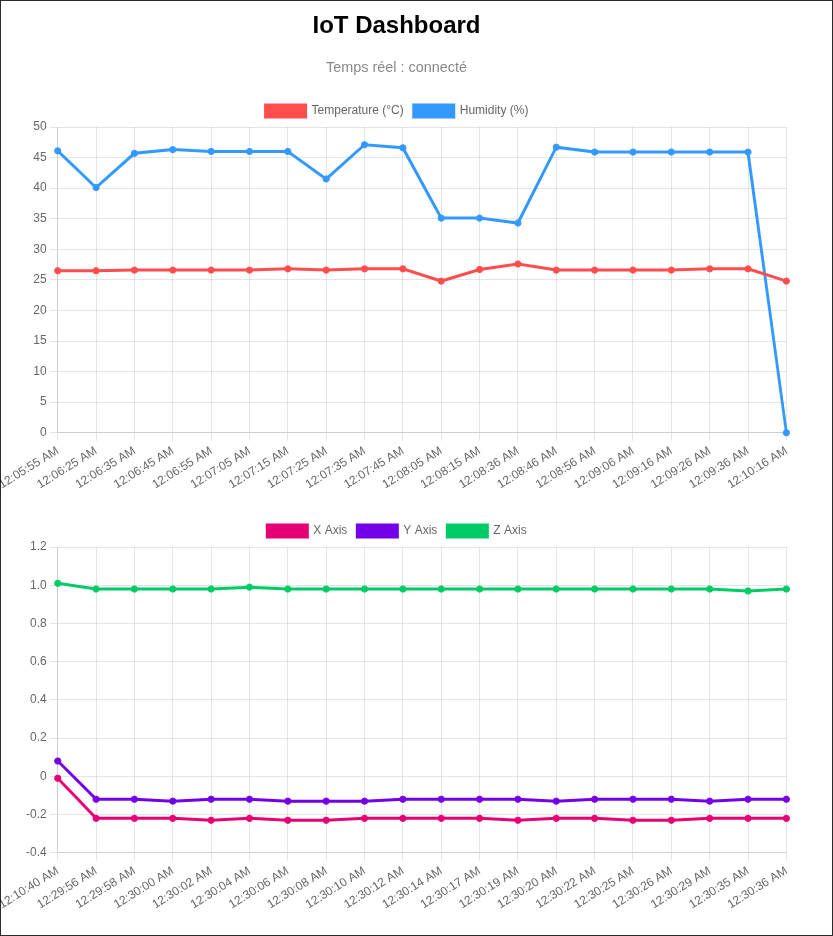
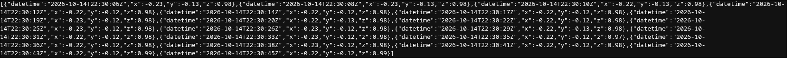
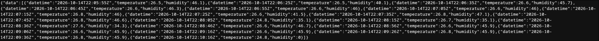
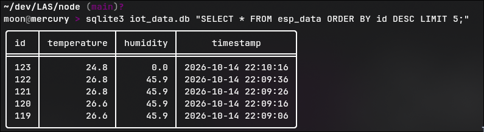

# Lab 1 : Acquisition et visualisation de données de capteurs en temps réel

Deux microcontrôleurs envoient leurs mesures à un serveur Node.js par deux protocoles différents. Le serveur les stocke dans SQLite, les affiche en temps réel avec Chart.js et les expose en JSON.

| Carte | Capteur | Protocole vers Node | Fréquence |
|---|---|---|---|
| ESP32 | DHT11 (température, humidité) | **TCP** (sockets), port 8080 | 10 s |
| Arduino Nano 33 IoT | Accéléromètre LSM6DS3 (x, y, z en g) | **HTTP** (POST JSON), port 3000 | 2 s |

**Bonus (partie 6)** : l'ESP32 et le Nano échangent aussi directement en TCP (ESP32 serveur, Nano client).

## Architecture

```
ESP32 + DHT11 ──── TCP :8080 ────┐
      ▲                           ▼
      │ TCP :5000          ┌─────────────┐   WebSocket   ┌────────────────────┐
      │ (bonus)            │  Node.js    │ ────────────► │ Navigateur         │
      ▼                    │  (Express,  │               │ (Chart.js)         │
Nano 33 IoT ─── HTTP :3000 ►  ws, TCP)   │ ◄──── GET ─── │ /nano_data         │
  + accéléromètre          └──────┬──────┘               │ /esp_data          │
                                  │                      └────────────────────┘
                                  ▼
                              SQLite (iot_data.db)
```

### Structure du dépôt

```
arduino/
  esp32_dht11_tcp/esp32_dht11_tcp.ino
  nano33_accelerometer_http/nano33_accelerometer_http.ino
node/
  server.js                      # serveurs HTTP, WebSocket et TCP
  config/database.js             # connexion SQLite et création des tables
  models/sensorModel.js          # requêtes SQL
  controllers/sensorController.js# validation, insertion, diffusion WebSocket
  routes/sensorRoutes.js         # routes HTTP
  services/websocketService.js   # diffusion aux clients WebSocket
  public/index.html              # dashboard Chart.js
```

## Matériel

- Arduino Nano 33 IoT
- ESP32 Dev Module
- Capteur DHT11
- Breadboard et jumpers
- Ordinateur avec Node.js (version 20.17 ou plus récente) et un réseau WiFi 2.4 GHz commun aux deux cartes et à l'ordinateur

## Câblage du DHT11 sur l'ESP32

| DHT11 | ESP32 |
|---|---|
| VCC (+) | 3V3 |
| GND (-) | GND |
| DATA (S) | GPIO 17 |

<!-- À VÉRIFIER avec le montage réel, puis ajouter la photo/le schéma : -->


L'accéléromètre du Nano 33 IoT est intégré à la carte (puce LSM6DS3), aucun câblage n'est nécessaire.

## Installation

### 1. Serveur Node.js

```bash
cd node
npm install
npm start
```

Le serveur écoute sur :
- **3000** : HTTP (API, dashboard) et WebSocket
- **8080** : TCP (données de l'ESP32)

La base `iot_data.db` est créée automatiquement au premier lancement. Vérifier que le pare-feu de l'ordinateur autorise les ports 3000 et 8080 en entrée sur le réseau local.

### 2. Arduino

**Cartes** (Gestionnaire de cartes) : `esp32` (Espressif) et `Arduino SAMD Boards`.

**Bibliothèques** (Gestionnaire de bibliothèques) :
- ESP32 : `DHT sensor library` et `Adafruit Unified Sensor` (Adafruit)
- Nano : `WiFiNINA`, `ArduinoHttpClient`, `Arduino_LSM6DS3`

**Paramètres à adapter dans les sketches** :

| Constante | Sketch | Valeur |
|---|---|---|
| `WIFI_SSID`, `WIFI_PASS` | les deux | identifiants du WiFi |
| `SERVER_IP` | les deux | IP de l'ordinateur qui fait tourner Node (`hostname -I`) |
| `USE_STATIC_IP` | ESP32 | `false` en DHCP (voir ci-dessous) |
| `ESP32_IP` | Nano | IP de l'ESP32 |

**Ordre de mise en route** :
1. Lancer le serveur Node.
2. Téléverser l'ESP32, ouvrir son moniteur série (115200 bauds) et noter l'IP affichée (`Connecte, IP ESP32 : ...`).
3. Reporter cette IP dans `ESP32_IP` du sketch du Nano, puis le téléverser.
4. Ouvrir `http://localhost:3000`.

> Les adresses IP sont attribuées par DHCP. Pour éviter qu'elles changent, réserver l'IP de l'ordinateur et celle de l'ESP32 dans l'interface de la box.

## Utilisation

### Dashboard

`http://localhost:3000` affiche deux graphiques :
- Température et humidité (ESP32)
- Axes X, Y, Z de l'accéléromètre (Nano)

Au chargement, les 20 dernières mesures sont récupérées via l'API, puis les nouvelles arrivent en direct par WebSocket (20 points maximum affichés). La page se reconnecte seule si le serveur redémarre.

### API

| Méthode | Route | Description |
|---|---|---|
| `POST` | `/api/arduino-data` | Réception des mesures du Nano (`{"x":0.01,"y":-0.02,"z":1.00}`). `400` si une valeur n'est pas un nombre. |
| `GET` | `/nano_data` | 20 dernières mesures de l'accéléromètre, de la plus ancienne à la plus récente |
| `GET` | `/esp_data` | 20 dernières mesures température/humidité, dans `{"data": [...]}` |

Exemple de réponse de `/esp_data` :

```json
{"data":[{"datetime":"2026-10-14T22:06:45Z","temperature":26.6,"humidity":46.3}]}
```

Les dates sont en ISO 8601, UTC.

### Base de données

Deux tables SQLite :

```sql
esp_data  (id, temperature REAL, humidity REAL, timestamp DATETIME DEFAULT CURRENT_TIMESTAMP)
nano_data (id, x REAL, y REAL, z REAL,           timestamp DATETIME DEFAULT CURRENT_TIMESTAMP)
```

```bash
sqlite3 iot_data.db "SELECT * FROM esp_data ORDER BY id DESC LIMIT 5;"
```

## Protocoles : HTTP et TCP

**Format de messages** : les deux cartes envoient du JSON.
- Nano (HTTP) : corps de la requête, `{"x":0.03,"y":0.02,"z":1.01}`
- ESP32 (TCP) : une ligne par message, terminée par `\n`, `{"temperature":26.5,"humidity":45.7}`

| | HTTP (Nano) | TCP brut (ESP32) |
|---|---|---|
| Modèle | Requête / réponse | Flux d'octets continu, connexion persistante |
| Structure du message | Définie par le protocole (méthode, URL, en-têtes, corps) | À définir soi-même (ici : JSON + `\n`) |
| Délimitation des messages | Gérée par HTTP (`Content-Length`) | À gérer côté serveur : un événement `data` peut contenir plusieurs messages ou un message coupé |
| Retour d'information | Code de statut (`200`, `400`, `500`) | Aucun, sauf si on l'implémente |
| Poids par message | Plus lourd (en-têtes) | Très léger |
| Côté serveur | Framework (Express), routes, parsing JSON | `net.createServer` et découpage manuel |
| Cas d'usage | Envois ponctuels, intégration web | Flux continu, faible surcharge |

Côté serveur, le TCP est donc découpé par un buffer par connexion : on accumule les octets reçus et on traite chaque ligne complète (`server.js`).

## Bonus : échange direct ESP32 ↔ Nano

- L'**ESP32** démarre un `WiFiServer` sur le port **5000**. À chaque mesure du DHT11, il envoie la ligne JSON au Nano en plus de Node.
- Le **Nano** se connecte à l'ESP32 avec un `WiFiClient` (reconnexion toutes les 5 s) et lui envoie ses valeurs x, y, z à chaque mesure, en plus de son POST HTTP vers Node.
- Chaque carte affiche sur son moniteur série ce qu'elle reçoit de l'autre (`[Nano] Accelerometre recu : ...` côté ESP32, `[ESP32] Temp/Hum recues : ...` côté Nano).

Test manuel de l'ESP32 depuis l'ordinateur : `nc -v <IP_ESP32> 5000`.

## Tests et validation

Le serveur peut être testé sans les cartes :

```bash
# HTTP (simule le Nano)
curl -X POST http://localhost:3000/api/arduino-data \
  -H "Content-Type: application/json" -d '{"x":0.01,"y":-0.02,"z":1.00}'

# TCP (simule l'ESP32)
echo '{"temperature":22.5,"humidity":48.0}' | nc localhost 8080

# API
curl http://localhost:3000/nano_data
curl http://localhost:3000/esp_data
```

Vérifications effectuées avec les deux cartes :

- [x] Communication TCP (ESP32 → Node) et HTTP (Nano → Node)
- [x] Données stockées en base
- [x] Graphiques cohérents avec les mesures, mise à jour en temps réel
- [x] Échange bidirectionnel ESP32 ↔ Nano
- [x] Reconnexion automatique après arrêt/redémarrage du serveur Node et après débranchement de l'ESP32

### Captures d'écran

<!-- Ajouter les captures dans docs/images/ -->
| | |
|---|---|
| Dashboard |  |
| `/nano_data` |  |
| `/esp_data` |  |
| Base SQLite |  |
| Moniteur série ESP32 |  |
| Moniteur série Nano |  |

## Limites connues

- **Pas de file d'attente** : si le serveur Node est arrêté, les mesures émises pendant ce temps sont perdues (visible dans la base par des trous dans les horodatages).
- **Mesures de humidité aberrantes** : le DHT11 renvoie parfois `0 %` (valeur hors de sa plage de 20 à 90 %), notamment juste après le démarrage. Ces valeurs ne sont pas filtrées. Le DHT11 a aussi une précision d'environ ±5 % d'humidité.
- **Nano mono-tâche** : pendant une requête HTTP bloquée (serveur injoignable), la lecture des messages de l'ESP32 est retardée, puis rattrapée d'un coup.
- **Réseau** : les adresses IP sont en DHCP, elles peuvent changer et obliger à mettre à jour les sketches. Les cartes ne supportent que le WiFi 2.4 GHz.
- **Sécurité** : pas d'authentification ni de chiffrement (HTTP et TCP en clair), usage limité à un réseau local de laboratoire.
